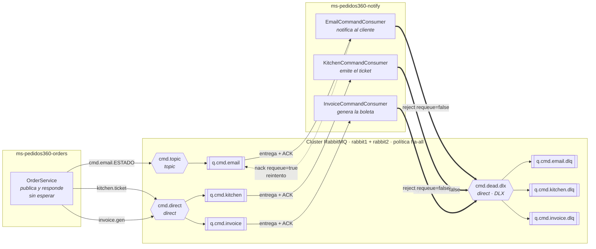

# Topología de mensajería de Pedidos360

Componentes, las **6 colas** y los **3 consumidores**. Este archivo se renderiza solo en GitHub y en
VS Code; no hace falta ninguna herramienta.

> Versión interactiva, con los cuatro escenarios de falla de la presentación:
> **https://claude.ai/artifact/75XxsVndFkzwhoJtW5UYRt**

---

## El diagrama



---

## Las seis colas

| Cola | Tipo | Exchange | Routing key | Quién la consume |
|---|---|---|---|---|
| `q.cmd.email` | comandos | `cmd.topic` | `cmd.email.<estado>` | `EmailCommandConsumer` |
| `q.cmd.kitchen` | comandos | `cmd.direct` | `kitchen.ticket` | `KitchenCommandConsumer` |
| `q.cmd.invoice` | comandos | `cmd.direct` | `invoice.gen` | `InvoiceCommandConsumer` |
| `q.cmd.email.dlq` | muerta | `cmd.dead.dlx` | `email.send` | nadie — se inspecciona |
| `q.cmd.kitchen.dlq` | muerta | `cmd.dead.dlx` | `kitchen.ticket` | nadie — se inspecciona |
| `q.cmd.invoice.dlq` | muerta | `cmd.dead.dlx` | `invoice.gen` | nadie — se inspecciona |

Cada cola principal se declara con `x-dead-letter-exchange = cmd.dead.dlx`, así que el
re-enrutamiento al rechazar un mensaje lo hace **el broker**, no el código. Ver
`RabbitTopologyConfig.java`.

### Por qué topic para el correo y direct para el resto

Son dos necesidades distintas. Cocina y boleta tienen un destino único y conocido: `direct`, por
coincidencia exacta, es lo más simple y predecible. El correo depende del estado del pedido y es
probable que mañana más de un servicio quiera escucharlo: `topic` permite suscribirse por patrón
(`cmd.email.#`) sin modificar el publicador.

---

## Tres caídas distintas

Una cola **no «se cae»**: vive en el broker. Lo que se cae es el consumidor o el nodo — y un mensaje
puede fallar sin que nada se caiga.

| Qué se cae | Qué pasa realmente | Mecanismo |
|---|---|---|
| **El consumidor** | La cola acumula y retiene. Al volver, procesa lo pendiente: cero pérdidas | Cola durable + ACK manual |
| **El mensaje** (falla al procesarse) | Reenvío una vez; si vuelve a fallar, cola muerta con el motivo en el log | `basicNack` / `basicReject` + DLX |
| **El nodo** del broker | La réplica del otro nodo es promovida; el cliente AMQP reconecta solo | Clúster de 2 nodos + `ha-all` |

Los cuatro escenarios se reproducen en vivo con:

```bash
bash infra/demo-presentacion.sh                      # actos 1 a 3
bash infra/demo-presentacion.sh --con-caida-de-nodo   # agrega la caída del nodo
```

---

## Cuántos mensajes produce cada transición

Un solo cambio de estado **no** llena las tres colas:

| Transición | Mensajes que publica |
|---|---|
| Cualquier cambio de estado | **email**, por el `topic`, con clave `cmd.email.<estado>` |
| → `ACEPTADO` | + **cocina**, por el `direct` |
| → `ENTREGADO` | + **boleta**, por el `direct` |

Recorrer `CREADO → ACEPTADO → EN_PREPARACION → DESPACHADO → ENTREGADO` produce **6 mensajes**:
4 de email, 1 de cocina y 1 de boleta.

---

## Dónde se monitorea

| Qué | Dónde |
|---|---|
| **Las colas** (Ready, Unacked, tasa, consumidores) | UI de gestión de RabbitMQ: `:15672` y `:15673` |
| **Los servicios** (logs de los consumidores y de la DLQ) | CloudWatch Logs, grupo `/pedidos360/compose` |

CloudWatch requiere levantar el stack con la superposición:

```bash
docker compose -f docker-compose.yml -f docker-compose.cloudwatch.yml up -d
```

y que la instancia EC2 tenga un perfil de IAM con `logs:PutLogEvents` (en AWS Academy,
`LabInstanceProfile`). Ver los comentarios de `docker-compose.cloudwatch.yml`.

---

## Dónde está cada cosa en el código

| Qué | Archivo |
|---|---|
| Nombres de colas, exchanges y routing keys | `application.yml` (`pedidos360.messaging.rabbit`) |
| Declaración de `Queue`, `Exchange` y `Binding` | `config/RabbitTopologyConfig.java` |
| ACK, reenvío y envío a la cola muerta | `messaging/support/CommandProcessor.java` |
| Los 3 consumidores | `messaging/{email,kitchen,invoice}/*CommandConsumer.java` |
| Administración de colas por REST | `ms-pedidos360-rabbit-admin` |
